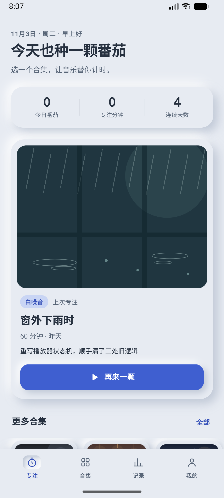
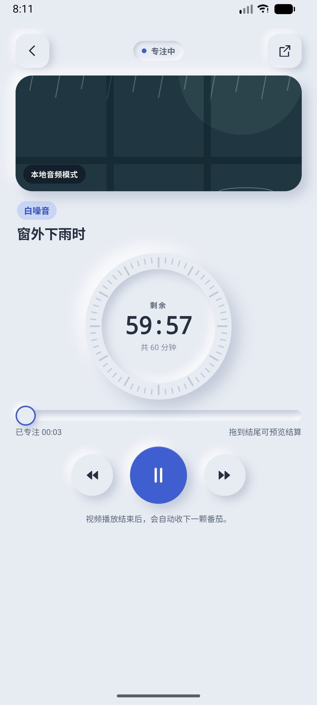
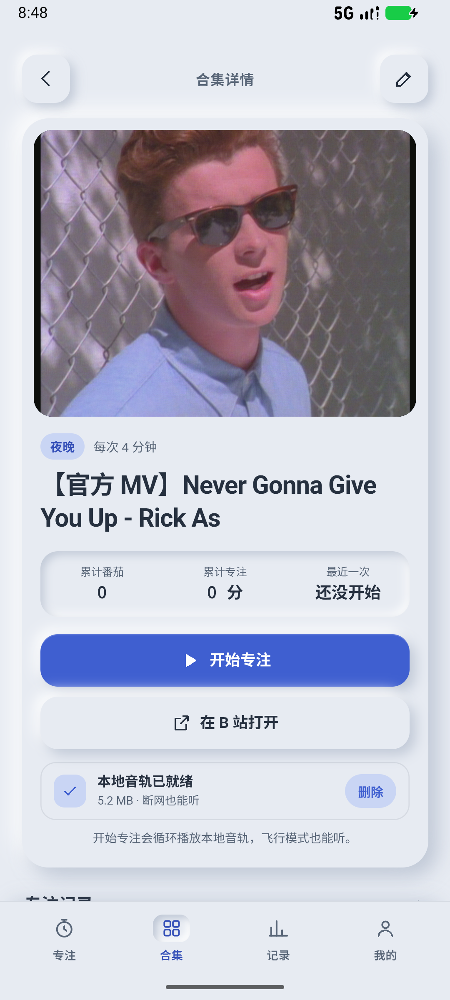

# 番茄专注 · Potato Clock

一个用**音乐**代替钟表来计时的番茄钟。

选一个 B 站音乐合集，音轨放完，这颗番茄就自动收下。没有倒计时数字盯着你看，只有一段音乐陪你把这段时间坐完。

  

---

## 为什么做这个（Why）

我平时习惯一边听 B 站的学习 music 合集一边看书，本来也在用番茄钟。但用久了发现一个问题：

**番茄钟最大的干扰，是那个数字本身。**

25 分钟里我会抬头看十几次还剩多久，看完还剩 12 分钟又开始算「要不要干脆停下来」。倒计时的存在感太强，反而把注意力从事情上拽走了。

后来有一次听一个 60 分钟的钢琴合集，弹完刚好一段完整的专注时间。我就想：为什么不干脆让音乐自己当钟？

- 一首 38 分钟的钢琴曲，就是一颗 38 分钟的番茄；
- 音乐放完 = 这一颗番茄结束，不需要我抬头确认；
- 中途要休息，按暂停就行，不用管数字走到哪了。

所以这个项目的核心不是「番茄钟 + 音乐播放器」两个功能的并列，而是**把计时这件事本身交给音乐**。界面上的圆环、进度是给事后回顾用的，不是给你盯着的。

另外两个附带的好处：

1. **B 站合集本身就带「主题」**——窗外下雨、深夜钢琴、咖啡馆白噪音。这些比「专注 25 分钟」更能帮人进入状态。
2. **音轨下载到本地**后，切后台、锁屏、飞行模式都不会断，专注过程不会被网络问题打断。

目标用户只有我自己，**不打算上架应用商店**，所以一些地方（比如 debug 签名、没有隐私政策页）是刻意留着的。

---

## 它是怎么运作的

```
B 站分享链接 / 短链 / av 号
        │
        ▼
 原生层解析（绕过 CORS 与 302 限制）── 标题 / 时长 / 封面
        │
        ▼
 下载音轨到 App 私有目录 ── 可离线播放
        │
        ▼
 WebView 页面里的 audio 播这轨音频 ── timeupdate 驱动番茄进度
        │
        ▼
 播完 → 自动结算这颗番茄 → 落一条记录
```

几个关键设计：

- **进度跟着音频走**，不跟 `setInterval` 走。所以音频卡住、拖动进度条、锁屏，进度都不会和声音错开。
- **进度单独存一份**（`fanqie.focus.v1`），每 5 秒落一次盘，杀进程之后重开能从原位接回，不会整颗归零。
- **专注期间挂前台服务**，把进程优先级抬到「用户可见」，锁屏和切后台都不被系统回收。
- **音轨一律用桌面 UA 请求**。B 站 CDN 会拒绝移动浏览器 UA 的匿名取流，这是踩了两版才找出的真凶（详见 [交付说明.md](交付说明.md) 第 11 条）。

---

## 功能

**专注计时**

- 合集单次时长可选（以视频真实时长为准），播完自动结算，不循环
- 暂停 / 继续、拖动进度条预览结算、按返回收起播放页但计时继续
- 无音轨时按 `Date.now()` 差值计时，后台被节流也不会少记
- 杀进程 / 重启后恢复：冷启动不自动出声，首页显示「已暂停 · 继续专注」

**合集管理**

- 粘贴 B 站链接、`b23.tv` 短链、带标题的整段分享文案、`av` 号都能解析
- 自动取标题、时长、封面；封面下载到本地缓存，弱网也能显示
- 主题标签（白噪音 / 钢琴 / 雨声…）可自定义增删排序，支持搜索与排序
- 旧合集（只存了搜索链接的）可以补一次视频链接再下载音轨

**音轨**

- 新建合集时自动后台下载，显示百分比与文件大小，可单独删除
- 多 CDN 节点轮询 + 退避重试 + buvid 标识刷新
- 失败时按节点报真实原因（403 / 超时 / DNS / TLS），日志写 `files/media/audio-download.log`

**记录与档案**

- 每次专注可写一句备注，记录页按周回看
- 首页统计今日番茄、专注分钟、连续天数
- 头像可换（系统图库 → 居中裁剪 256×256 → 压 JPEG 存本地）
- 浅色 / 米黄主题

---

## 使用方式

### 一、直接装 APK（推荐，功能完整）

1. 下载本仓库根目录的 `番茄专注-1.1.6.apk`，传到手机（微信文件传输助手 / USB / 网盘都行）。
2. 手机上点开安装，首次会提示「未知来源应用」，允许即可。
3. **覆盖安装会保留原有合集与专注记录**，不用先卸载。

要求：Android 8.0（API 26）及以上。这是 debug 签名的测试包，能正常安装使用，但不能上架商店。

USB 连着电脑时也可以：

```bash
adb install -r 番茄专注-1.1.6.apk
```

第一次点「开始专注」时 Android 13+ 会问一次通知权限，允许后通知栏才会显示「专注中」；拒绝也不影响计时。

### 二、网页版（无需安装，能力有折扣）

`index.html` 是一个自包含的单文件页面（CSS / JS 全内联，无外部依赖），直接用浏览器打开就能用：

```bash
# 用任意静态服务器，或直接双击 index.html
python -m http.server 8080
```

也可以把整个目录丢到 GitHub Pages / Netlify / Vercel，手机 Chrome 打开后「添加到主屏幕」当 PWA 用。

**网页版做不到的事**（这些能力在原生层）：

- 读不了 `b23.tv` 短链和 B 站接口（浏览器跨域限制）→ 只能手动填标题、时长和音频地址
- 没有锁屏保活、没有通知栏
- 音轨不能下载到本地

### 三、把网页放进壳里

`android/` 是完整的 WebView 壳工程，改完 `index.html` 后：

```bash
# 方式一：双击，自动同步 + 编译 + 复制 APK 到根目录
android\build-apk.bat

# 方式二：Android Studio 打开 android/ 目录，点 ▶ Run
```

---

## 开发环境配置

| 项目 | 版本 |
|---|---|
| JDK | 17 及以上（本机实测 JDK 25，即 Android Studio 自带 JBR） |
| Gradle | 9.8.2（wrapper 自带，首次构建自动下载） |
| Android Gradle Plugin | 9.5.0 |
| compileSdk / targetSdk / minSdk | 37 / 36 / 26 |
| Android SDK Build-Tools | 随 compileSdk 37 一并通过 SDK Manager 安装 |

### 1. 装 JDK 与 Android SDK

最省事的做法是装 Android Studio，SDK 和 JBR 都自带。

### 2. 配置 SDK 路径

`android/local.properties`（此文件已 gitignore，需自己建）：

```properties
sdk.dir=C\:\\Users\\<你的用户名>\\AppData\\Local\\Android\\Sdk
```

或者设环境变量 `ANDROID_HOME`。

### 3. 配置 JAVA_HOME

`build-apk.bat` 会优先用环境变量 `JAVA_HOME`；没有的话会去 `D:\2Enviroment\Android Studio\jbr` 找（这是我本机的路径，你大概率要改这一行，或者干脆先设好 `JAVA_HOME`）。

```bash
# Git Bash
export JAVA_HOME="/c/Program Files/Android/Android Studio/jbr"

# 验证
"$JAVA_HOME/bin/java" -version
```

### 4. 构建

```bash
cd android
./gradlew assembleDebug          # Gradle 9.8.2 会自行下载
# 产物：android/app/build/outputs/apk/debug/app-debug.apk
```

国内网络已在 `android/settings.gradle.kts` 里配了阿里云镜像，依赖拉不下来时先看这里。

### 5. adb（可选）

`adb` 一般不在 PATH 里，位置在：

```
%LOCALAPPDATA%\Android\Sdk\platform-tools\adb.exe
```

---

## 工程结构

```
PotatoClock/
├── index.html                        ← 前端主文件（改界面只改这里）
├── 番茄专注-1.1.6.apk                ← 当前版本安装包
├── 交付说明.md                        ← 使用说明 + 按版本编号的修复记录
├── screenshots/                      ← 界面截图
└── android/
    ├── build-apk.bat                 ← 一键同步 + 打包 + 复制 APK
    ├── settings.gradle.kts           ← 仓库与镜像配置
    └── app/src/main/
        ├── assets/www/index.html     ← 打包用副本（由脚本同步，别手改）
        ├── java/com/fanqie/focus/
        │   ├── MainActivity.java     ← WebView 壳：安全区、返回键、跳转、换头像
        │   ├── BiliBridge.java       ← 短链解析、封面缓存、音轨下载、状态桥
        │   └── FocusService.java     ← 专注期间的前台服务 + MediaSession
        └── res/                      ← 图标、通知图标、启动背景
```

包名 `com.fanqie.focus`，当前 `versionCode 8` / `versionName 1.1.6`。

### 改代码时最容易踩的三条

1. **改完 `index.html` 必须同步到 assets。** 页面是从 `android/app/src/main/assets/www/index.html` 打进包的，不同步就是打进去一份旧界面。`build-apk.bat` 会自动 `copy`，手动构建时得自己来一次：

   ```bash
   cp index.html android/app/src/main/assets/www/index.html
   ```

2. **别把 `BiliBridge.UA` 改回手机 UA。** 那会直接把音轨下载变回 403，代码里留了注释。
3. **别用设计工具重新导出一份 `index.html` 覆盖。** 会丢掉原生桥接代码（`NATIVE`、`__potatoResolve`、`__potatoAudioProgress` 等）和音轨卡片逻辑。

### 版本号怎么改

`android/app/build.gradle.kts` 里改 `versionCode` / `versionName`，同时改 `build-apk.bat` 最后复制 APK 的文件名（脚本里写死了版本号）。

---

## 已知限制

- **音轨依赖 B 站接口的匿名访问**。哪天 B 站对桌面 UA 的匿名取流也收紧，就得带登录 Cookie 走 upos，那是另一个量级的改动。
- **付费内容 / 番剧取不到音轨**，B 站要求登录态。
- **极端省电模式仍可能被掐**。前台服务把优先级抬高了，但部分机型的「超级省电 / 深度睡眠」会无视它。要绝对稳定得换原生播放器（ExoPlayer + MediaSession），目前没做。
- **进度最多丢 5 秒**。每 5 秒落一次盘，暂停 / 拖动 / 切后台时立刻落。
- **数据只存在本机**，换机或重装就没了。导出 / 导入是下一步计划。

---

## 免责声明

- 本项目只用于**个人**的专注计时，不提供任何内容的分发。
- 音轨版权归 B 站原 UP 主所有，请勿二次分发或用于商业用途。
- 抓取的是 B 站公开接口，非官方支持，接口随时可能变化导致功能失效。
- 仓库里附带的 APK 是 debug 签名包，仅供自己安装测试。

## License

代码以 MIT 协议开源，见 [LICENSE](LICENSE)。
